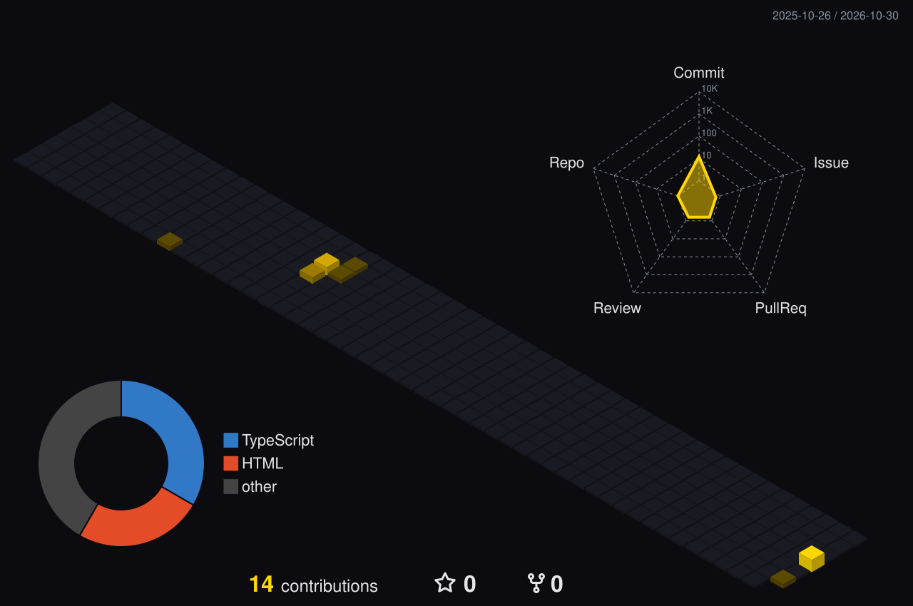

  

   

  

    

  

    
    
  

  

### Sobre

Desenvolvedor **Web** com foco em **Frontend**. Construo interfaces modernas, responsivas e acessíveis, com atenção a performance, arquitetura de componentes e experiência do usuário.

* Stack principal: **React**, **Next.js**, **TypeScript** e **Tailwind CSS**.
* Foco em código limpo, micro-interações e design consistente.
* Em constante evolução — disciplina e persistência acima de tudo.

> *"Eu tenho um poder. Eu nunca desisto."* — Batman

  

### Stack

  

  

### Estatísticas

  

  

### Contribuições

  

 

  

 

  

