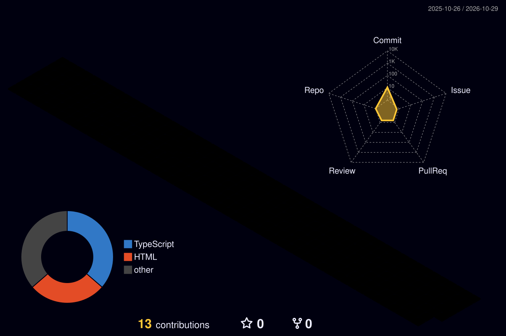

  # Olá, eu sou o Rafael Cardoso 👋

  

   

  <!-- Divisor Neon Animado -->
  

   

  

    
    
  

---

### 🚀 Sobre Mim

* 💻 Desenvolvedor focado em **Frontend Moderno**, interfaces responsivas e acessíveis.
* 🎨 Foco em **React**, **Next.js**, **TypeScript** e **Tailwind CSS**.
* ⚡ Apaixonado por criar experiências web com alta performance, micro-animações e design limpo.

---

### 🛠️ Tecnologias & Ferramentas

  

---

### 🏙️ Gráfico de Contribuições em 3D

  

---

### 🐍 Snake Game (Contribuições Animadas)

  <picture>
    <source media="(prefers-color-scheme: dark)" srcset="https://raw.githubusercontent.com/RafaelCardosodv/RafaelCardosodv/output/github-snake-dark.svg">
    <source media="(prefers-color-scheme: light)" srcset="https://raw.githubusercontent.com/RafaelCardosodv/RafaelCardosodv/output/github-snake.svg">
    
  </picture>

 

  <!-- Rodapé Divisor Neon Animado -->
  

